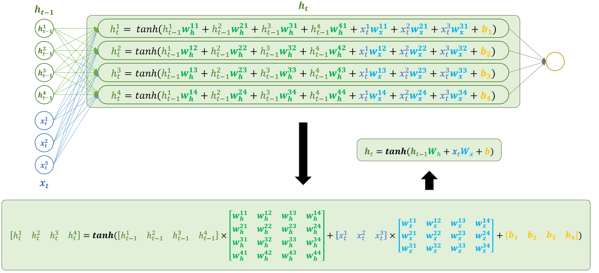
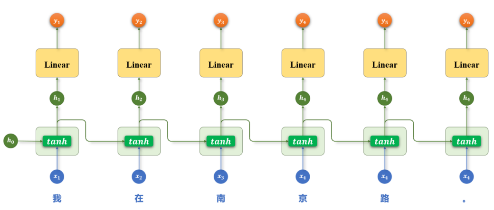
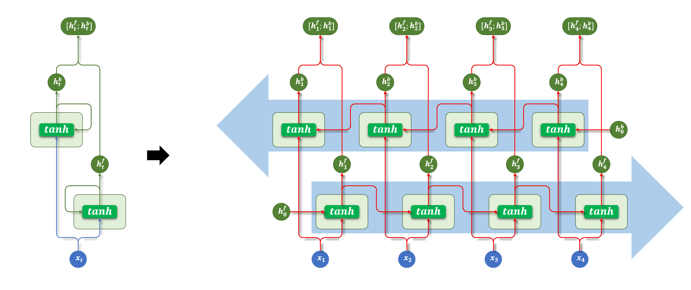
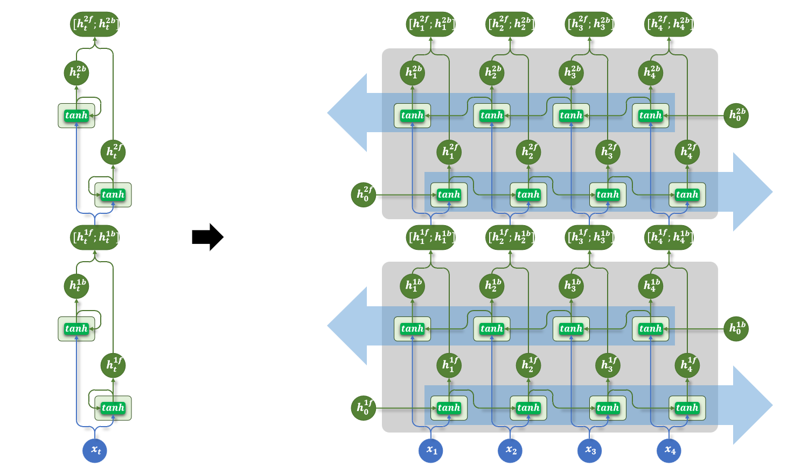
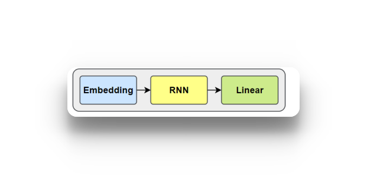
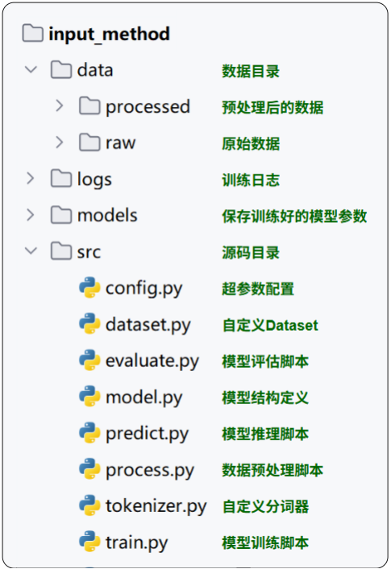

# 一、RNN
## 1. Word2Vec无法解决的问题
在前面，我们通过自己构建的词表然后通过Word2Vec算法，构建了每个词的词向量。然后通过 `torch.nn.Embedding()` 构建了词嵌入矩阵，可以查询一个句子的词嵌入矩阵。**但是**，这样有一个问题，Word2Vec 为每个词学习的是一个固定向量（**静态词向量**），而词在句子中的位置和前后顺序，会随着句子变化。
比如：词元的不同组合，但是查询到的词向量矩阵却是一样的 (“人咬狗”和“狗咬人”)，**这两句话的向量序列并不相同，只是包含相同的三个词向量。**
这是因为 **Word2Vec 它主要学习“这个词经常和哪些词一起出现”，并不直接编码“这次这个词位于哪里”。**
**tips:**
    可以回想一下之前的Skip-Gram算法，通过中心词去预测周围的词，输入一个词元，然后计算左边和右边词元的损失，算一个平均，再更新词向量，但是在这个过程中，这个次元前面的词元和后面词元调换一下顺序不会对损失产生任何影响，所以Word2Vec 并没有记住词元之间的顺序，而是记住了我们人为规定的：**这个词周围可能会出现什么词**这个规则。


更准确的说法是：Word2Vec 利用了文本中的邻近关系来学习词义，但标准训练方式**没有显式保留左右方向和位置顺序**。 词向量可能间接学到一些语法倾向，却无法单独表达某个词在当前句子中的位置和角色。

**所以**：要理解一句话，不能仅仅依靠词向量所表示的语义和词语之间的邻近关系，还需要结合词语的**顺序**和**上下文**，判断谁在执行动作、谁是动作的对象。例如，“人咬狗”和“狗咬人”包含相同的词语，却因为顺序不同而表达完全不同的含义。为此，可以引入循环神经网络（RNN）：它按照顺序逐个读取词向量，并通过隐藏状态传递前面已经读取的信息，使当前词的处理能够结合前文，从而学习词语之间的顺序关系和上下文依赖。

## 2. RNN
RNN（Recurrent Neural Network，循环神经网络） 会逐个读取句子中的词语，并在每一步结合当前词和前面的上下文信息，不断更新对句子的理解。通过这种机制，RNN 能够持续建模上下文，从而更准确地把握句子的整体语义。因此RNN曾是序列建模领域的主流模型，被广泛应用于各类NLP任务。

### 2.1 RNN的基础结构

$$
h_t = \tanh(x_t W_x + h_{t-1} W_h + b)
$$




### 2.2 多层RNN结构
为了让模型捕捉更复杂的语言特征，可以将多个 RNN 层按层次堆叠起来，使不同层学习不同层次的语义信息。
这种设计的核心假设是：底层网络更容易捕捉局部模式（如词组、短语），而高层网络则能学习更抽象的语义信息（如句子主题或语境）。
多层RNN结构中，**每一层的输出序列会作为下一层的输入时序序列**，最底层RNN接收原始输入序列，顶层 RNN的输出作为最终结果用于后续任务



### 2.3 双向RNN结构
基础的 RNN 在每个时间步只输出一个隐藏状态，该状态仅包含来自上文的信息，而无法利用当前词之后的下文。
对于一些任务而言，这是一个明显的限制。比如在序列标注任务中，模型需要为每个 token 预测一个标签，如果只能参考前文信息，往往难以做出准确判断。



### 2.4 RNN多层+双向结构
多层结构和双向结构还可组合使用，每层都是一个双向RNN


各种结构的RNN代码实操：
```python
import torch
import torch.nn as nn

input = torch.randn(2, 4, 3)

# 1.单层单向RNN
rnn = nn.RNN(
    input_size=3,
    hidden_size=4,
    num_layers=1,
    batch_first=True,
    bidirectional=False,
)

output, hn = rnn(input, None)
print(output.shape) # torch.Size([2, 4, 4])
print(hn.shape) # torch.Size([1, 2, 4])

# 2.单层双向RNN
rnn = nn.RNN(
    input_size=3,
    hidden_size=4,
    num_layers=1,
    batch_first=True,
    bidirectional=True,
)

output, hn = rnn(input, None)
print(output.shape) # torch.Size([2, 4, 8])
print(hn.shape) # torch.Size([2, 2, 4])

# 3.多层双向RNN
rnn = nn.RNN(
    input_size=3,
    hidden_size=4,
    num_layers=2,
    batch_first=True,
    bidirectional=True,
)

output, hn = rnn(input, None)
print(output.shape) # torch.Size([2, 4, 8])
print(hn.shape) # torch.Size([4, 2, 8])
```

案例实操：**智能输入法**
本案例旨在实现一个用于手机输入法的智能词语联想模型。
具体需求为：根据用户当前已输入的文本内容，预测下一个可能输入的词语，要求返回概率最高的 5 个候选词供用户选择。
例如：向模型输入“自然语言”，模型输出[“处理”、“理解”、“的”、“描述”、“生成”] 
本任务采用基于循环神经网络（RNN）的语言模型结构来实现“下一词预测”功能。模型整体由以下三个主要部分组成：
1) **数据集**
    在本任务中，模型需要根据用户已输入的文本预测下一个可能输入的词语，因此训练数据应具备自然语言上下文连续性和贴近真实使用场景的特点。
    可选数据来源包括：
    1. 用户真实输入内容：如聊天记录、搜索历史、输入法日志等。这类数据最能反映真实输入场景，有助于模型学习用户输入习惯和上下文联想模式。
    2. 开放领域对话语料：如论坛回复、社交平台评论、闲聊对话等。这类语料具有较强的口语化特征，能够提升模型在真实输入场景中的泛化能力。
    本任务使用的数据集为https://huggingface.co/datasets/Jax-dan/HundredCV-Chat 
    为了构造适用于“下一词预测”任务的训练样本，首先需要对原始语料进行分词。随后，采用滑动窗口的方式，从分词后的序列中提取连续的上下文片段，并以每个窗口的下一个词作为预测目标，构成输入-输出对。
2) **模型架构**

    - 嵌入层（Embedding）
    将输入的词或字索引映射为稠密向量表示，便于后续神经网络处理。
    - 循环神经网络层（RNN）
    用于建模输入序列的上下文信息，输出最后一个时间步的隐藏状态作为上下文表示。RNN输出的结果包含了一个词的上下文信息，然后再经过一个线性层，将这个词的隐藏特征映射到词表大小的线性层，就得到了下一个词的预测概率
    - 输出层（Linear）
    将隐藏状态映射到词表大小的维度，生成对下一个词的概率预测。
3) **训练方案**
    - 损失函数
    下一个词的预测本质为多分类问题，所以损失函数采用 CrossEntropyLoss，其结合了softmax和交叉熵计算。
    - 优化器
    使用 Adam 优化器，具有较强的收敛能力和稳定性。

提问：**经过RNN后我们得到了每个词元包含上下文信息的隐藏状态，为什么经过一个线性层和softmax之后就可以转换为下一个词的预测概率？**
**答：** 注意看我们整个模型的训练过程，首先我对训练集的每个词元的嵌入表达进行随机初始化，然后经过RNN，然后再经过线性层。我们的训练目标是什么？就是**将一个窗口的下一个词作为目标**，经过损失函数之后优化嵌入矩阵。那么训练结束之后，损失收敛之后，这个模型就天然具备了预测能力，而是因为训练过程让 Linear 的每个输出位置学会了对应词语的预测规律。

实现：


**思考:** 从RNN的计算过程就可以看出，RNN的训练过程一定是很慢的
最主要的原因是：**序列中的各个时间步存在依赖，必须按顺序计算，难以充分发挥 GPU 的并行能力。**
#### 1. 时间步之间存在依赖

例如，使用 RNN 处理一句话：

> 我 → 今天 → 想 → 吃 → 火锅

每一步的计算为：

$$
h_t = \tanh(x_t W_{ih} + h_{t-1} W_{hh} + b)
$$

其中：

- $x_t$：当前词的词向量。
- $h_{t-1}$：上一个时间步的隐藏状态。
- $h_t$：当前时间步的隐藏状态。
- $W_{ih}$、$W_{hh}$：可训练的权重矩阵。
- $b$：偏置。

由于当前隐藏状态依赖上一步的隐藏状态：

- 计算“今天”的隐藏状态，需要先得到“我”的隐藏状态。
- 计算“想”的隐藏状态，需要先得到“今天”的隐藏状态。
- 后面的词也必须依次等待。

**即使整句话的词向量都已准备好，隐藏状态仍然不能一次性全部算出来。**

#### 2. GPU 并行能力利用不足

GPU 擅长同时执行大量计算，但 RNN 在同一条序列中需要逐步计算。

RNN 并不是完全不能并行：

- 同一个 batch 中的多条序列可以并行计算。
- 每个时间步内部的矩阵运算可以并行计算。
- 输入部分的线性变换可以提前批量计算。

**主要限制在于：同一条序列的隐藏状态需要沿时间步依次计算。**

#### 3. 训练需要沿时间反向传播

RNN 训练使用时间反向传播（BPTT）。

前向传播需要依次计算各个时间步的隐藏状态；反向传播则需要沿时间传递梯度，计算各步对参数的影响。

因此，序列越长：

- 前向传播的计算步骤越多。
- 反向传播的计算步骤越多。
- 需要保存的中间状态越多，显存占用通常也越大。

#### 4. 隐藏维度和层数会增加计算量

隐藏状态之间的变换涉及：

$$
h_{t-1} W_{hh}
$$

如果隐藏维度为 $H$，那么 $W_{hh}$ 的大小为 $H \times H$。

这一部分每个时间步的计算量大致与 $H^2$ 成正比。因此，隐藏维度翻倍，这部分计算量大约增加到原来的四倍。

增加 RNN 层数，也会增加每个时间步需要执行的计算。

### 3.RNN 存在的问题
#### 3.1 前面说的，RNN的训练过程无法并行，导致训练效率很低
#### 3.2 RNN在训练过程中，当输入序列很长时，模型难以有效学习早期输入对最终输出的影响。
**根本原因：反向传播时，梯度需要沿时间步连续相乘，序列越长，相乘的次数越多。**

RNN 的隐藏状态计算为：

$$
h_t = \tanh(W_h h_{t-1} + W_x x_t + b)
$$

详细的计算过程为：


令激活函数的输入为 $u_t$，则相邻时间步之间的局部导数为：

$$
\frac{\partial h_t}{\partial h_{t-1}}
=
\mathrm{diag}\left(\tanh'(u_t)\right)W_h
$$

训练时采用时间反向传播（BPTT），最终损失传回早期隐藏状态的梯度，需要连续乘上这些局部导数：

- **梯度消失**：如果连续相乘使梯度不断缩小，早期时间步获得的梯度就会趋近于零，模型难以学习早期输入对最终输出的影响。
- **梯度爆炸**：如果连续相乘使梯度不断放大，梯度可能呈指数级增长，导致参数更新不稳定。

其中，$\tanh'(u_t)$ 的范围是 $(0,1]$。当 `tanh` 进入饱和区域时，其导数接近零，会进一步加剧梯度消失。

##### 更换为 ReLU 能解决这个问题吗？

**ReLU 可以缓解梯度消失，但不能彻底解决。** 在输入大于零时，ReLU 的导数为 1，避免了 `tanh` 导数较小造成的梯度衰减；但梯度仍需连续乘上权重矩阵 $W_h$，因此仍可能消失或爆炸。此外，ReLU 在输入小于零时导数为 0，也会阻断梯度传播。

因此，RNN 通常使用 **LSTM 或 GRU** 来改善长期依赖的学习，并通过**梯度裁剪**控制梯度爆炸。

**下文中提到的LSTM就是为了解决RNN梯度消失或者梯度爆炸的问题的**

# 二、LSTM （Long Short-Term Memory, LSTM）