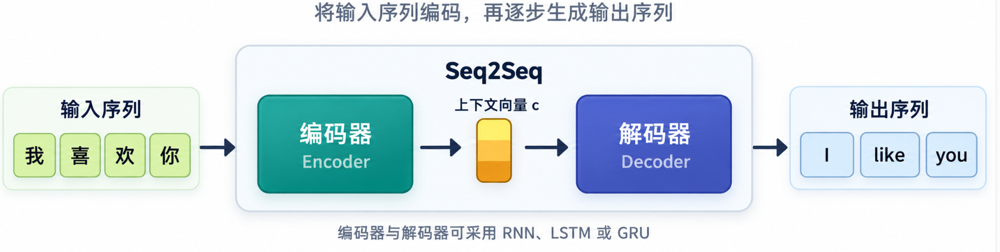
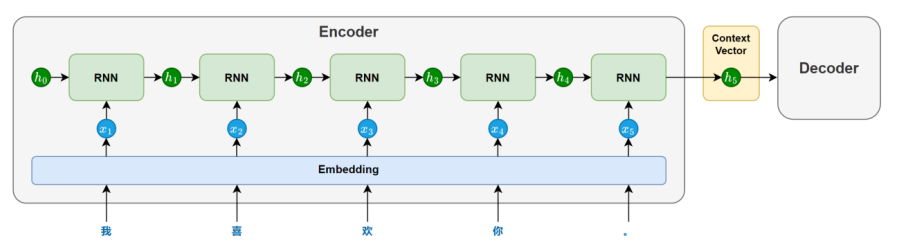
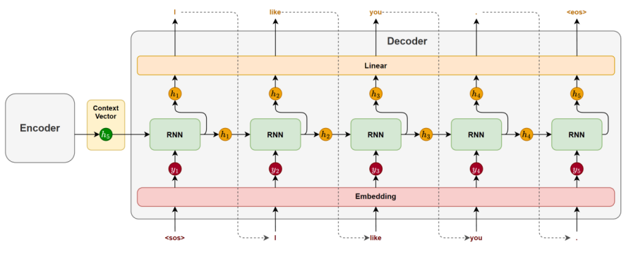
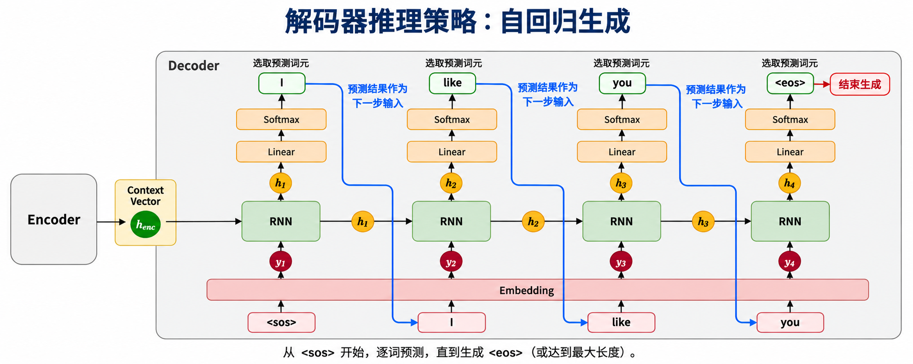
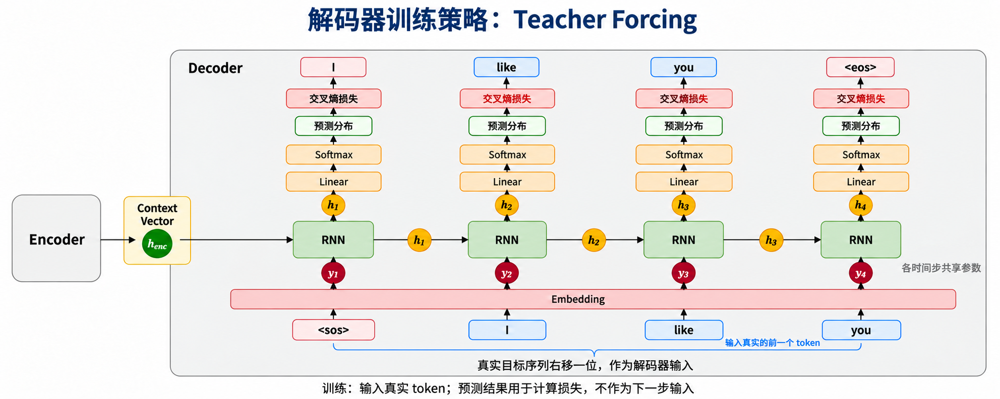
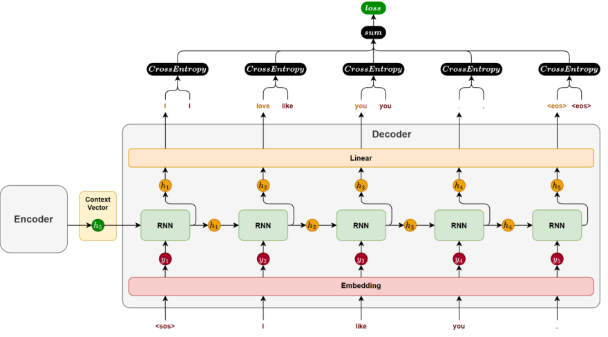

# 概述
我们在前面接触到的三个传统序列模型，RNN,LSTM,GRU都是**通过隐藏状态传递历史信息，对序列进行建模**：
- RNN：将当前输入与上一时刻的隐藏状态结合，结构简单，但容易出现梯度消失或爆炸，难以学习长期依赖。
- LSTM：引入细胞状态以及遗忘门、输入门、输出门，控制信息的保留、写入和输出，更有效地学习长期依赖。
- GRU：通过更新门和重置门控制信息流动，结构比 LSTM 更简洁、参数更少，通常也能取得较好的效果。
需要注意，它们并不局限于“静态输出”，既可以对整个序列输出一个结果，也可以在每个时间步输出结果。但面对机器翻译、文本摘要这样的任务，**输入和输出的长度可能不同**，也不需要逐个位置对应，仅靠常见的序列分类或逐步预测结构就不够方便。

**因此，我们进一步引入 Seq2Seq（序列到序列）模型：由编码器理解输入序列，再由解码器逐步生成输出序列，从而实现不同长度序列之间的转换。编码器和解码器都可以由 RNN、LSTM 或 GRU 构成。**

## 1.Seq2Seq模型架构
**所以，Seq2Seq 是一种组织序列模型的架构，而 RNN、LSTM、GRU 是构建它的基础组件。**
Seq2Seq 模型由一个编码器（Encoder）和一个解码器（Decoder）构成。编码器负责提取输入序列的语义信息，并将其压缩为一个固定长度的上下文向量（Context Vector）；解码器则基于该向量，逐步生成目标序列。

### 1.1 编码器 (encoder)

编码器主要由一个 **循环神经网络（RNN/LSTM/GRU）** 构成，其任务是**将输入序列的语义信息提取并压缩为一个上下文向量。**

### 1.2 解码器 (decoder)

解码器主要也由一个 **循环神经网络（RNN / LSTM / GRU）** 构成，其任务是基于编码器传递的上下文向量，逐步生成目标序列

在生成开始时，循环神经网络**以上下文向量作为初始隐藏状态**，并接收一个特殊的起始标记 <sos>（start of sentence）作为第一个时间步的输入，用于预测第一个 token。
随后，在每一个时间步，**模型都会根据前一时刻的隐藏状态和上一步生成的 token，** 预测当前的输出。这种“将前一步的输出作为下一步输入”的方式被称为**自回归生成（Autoregressive Generation）**，它确保了生成结果的连贯性。
生成过程会持续进行，直到模型生成了一个特殊的结束标记 <eos>（end of sentence），表示句子生成完成。

## 2. 模型训练和推理机制

### 2.1 编码器
首先，编码器很简单，接收一个序列，通过嵌入层和循环神经网络层（RNN/LSTM/GRU）的处理，将整个序列编码为一个上下文向量

### 2.2 解码器
解码器使用 编码器输出的上下文向量 **初始化隐藏状态**，然后逐步生成目标序列，但是注意：**解码器中训练阶段和推理阶段的策略是不一样的**

#### 2.2.1 解码器推理策略
在推理阶段，解码器采用的是 **自回归生成** 的方式，每一个时间步的输入是模型 解码器上一个时间步的预测结果

**存在的问题： 词选择**
在推理阶段，每一个时间步使用上一个时间步的预测结果，然后经过线形层和softmax映射到词表大小的概率，**那么当前时间步怎么从这个词表中选择词作为当前时间步的预测结果呢？**

**有两种策略**

- **贪心解码（Greedy Decoding）**
    **每一步都选择概率最高的词。**
    优点：简单高效
    缺点：容易陷入局部最优，生成不够多样。
- **束搜索（Beam Search）**
    **每一步保留多个候选词序列（如 beam size = 3），并在扩展后选择得分最高的完整句子。**
    优点：全局考虑，生成质量高
    缺点：计算开销大

#### 2.2.2 解码器训练策略
在训练阶段，通常采用 **Teacher Forcing（教师强制）策略**：解码器在每个时间步接收**真实目标序列中前一个位置的 token**，并学习预测当前位置的 token。其中，第一个时间步的输入为起始标记 <sos>。

**核心区别**：输入真实的前一个 token，预测分布与当前真实标签计算损失。

解码器训练和推理策略的比较：

| 对比项 | 训练阶段（Teacher Forcing） | 推理阶段（自回归生成） |
|---|---|---|
| **目的** | 根据真实标签学习模型参数 | 使用训练好的模型生成序列 |
| **首步输入** | 起始标记 `<sos>` | 起始标记 `<sos>` |
| **后续输入** | **真实目标序列的前一个 token** | **模型上一步预测的 token** |
| **输出用途** | 与当前真实 token 计算损失 | 选出 token，作为生成结果及下一步输入 |
| **参数更新** | 反向传播，更新参数 | 不更新参数 |
| **结束条件** | 按真实目标序列长度计算，通常屏蔽填充位置 | 生成 `<eos>` 或达到最大长度 |
| **错误累积** | 预测错误不会作为下一步输入继续传播 | 预测错误可能影响后续生成 |

这种做法带来了两个明显好处：
- **通常收敛更快，避免训练时错误逐步累积**：每一步都输入真实的前一个 token，即使上一步预测错误，也不会把错误词继续输入后续步骤，让模型始终在正确上下文中学习。
- **优化过程更稳定**：训练初期预测往往不准确，使用真实 token 能减少错误输入造成的干扰，使每一步的预测与监督目标更容易匹配

**最核心的区别：训练时由真实答案引导下一步，推理时依靠自己的预测继续生成。**

## 3. 损失计算

解码器每一步输出一个token的概率分布，我们通过交叉熵损失函数衡量模型对真实词的预测质量。训练过程中，每一个时间步都会产生一个损失值。该样本的总损失，就是所有时间步的损失值逐步累加的结果。
**解码器以真实的前一个 token 作为当前输入，预测当前 token 的概率分布，并与当前真实 token 计算交叉熵损失。该样本的损失通常由所有有效时间步的损失求和或取平均得到。**

# 二、真实案例-中英翻译V1.0
# 基于 Seq2Seq 的中英文机器翻译项目

## 1. 数据处理

本案例使用的数据集来自[阿里云天池平台](https://tianchi.aliyun.com/dataset/174937)，共包含 29,155 对中英文平行语句。原始文件为 TSV 格式，每行包含一对中文句子及其对应的英文翻译。

仅使用前两列数据：

- **源语言**：中文句子，作为编码器输入。
- **目标语言**：英文句子，作为解码器的学习目标。

### 1.1 分词与词表构建

中文与英文分别进行分词，并独立构建词表：

- **中文**：按字粒度分词。
- **英文**：使用 [NLTK 分词工具](https://www.nltk.org/howto/tokenize.html)。

词表包含以下特殊标记：

| 标记 | 作用 |
|---|---|
| `<pad>` | 补齐批次内不同长度的序列 |
| `<unk>` | 表示词表中未收录的 token |
| `<sos>` | 表示目标序列开始 |
| `<eos>` | 表示目标序列结束 |

### 1.2 数据集划分与序列处理

将数据划分为训练集、验证集和测试集，**仅使用训练集构建词表**，避免数据泄漏。

将分词结果转换为 Token ID，并在批次内进行填充，同时保留真实序列长度。

对于目标序列，构造错开一个位置的解码器输入与监督标签。例如：

- 原始译文：`I like you`
- 解码器输入：`<sos> I like you`
- 监督标签：`I like you <eos>`

## 2. 模型设计

采用经典的 **Seq2Seq 编码器—解码器架构**，通过上下文表示连接编码器与解码器。

### 2.1 编码器（Encoder）

编码器由以下部分组成：

1. **嵌入层（Embedding）**  
   将中文 Token ID 映射为稠密向量。

2. **双向循环神经网络（Bidirectional GRU）**  
   分别从前向和后向处理输入序列，提取双向上下文信息。拼接两个方向的最终隐藏状态，得到整个输入序列的上下文表示。

3. **状态映射层（按需设置）**  
   当拼接后的上下文表示与解码器隐藏状态维度不一致时，通过线性映射调整维度，用于初始化解码器隐藏状态。

> 对填充后的输入，应根据真实长度处理序列，避免填充位置影响最终上下文表示。

### 2.2 解码器（Decoder）

解码器由以下部分组成：

1. **嵌入层（Embedding）**  
   将当前输入的英文 Token ID 映射为稠密向量。

2. **单向循环神经网络（GRU）**  
   结合当前输入的词向量与上一时间步的隐藏状态，计算当前隐藏状态。

3. **全连接层（Linear）**  
   将当前隐藏状态映射为目标词表大小的分数向量，即 **logits**。

推理时，可通过 Softmax 将 logits 转换为词概率分布。

> Linear 层本身不输出概率。训练时，CrossEntropyLoss 直接接收 logits，无须提前执行 Softmax。

## 3. 训练方案

### 3.1 训练策略

采用 **Teacher Forcing（教师强制）策略**：

解码器在每个时间步接收真实目标序列中前一个位置的 token，并学习预测当前位置的 token。第一个时间步的输入为 `<sos>`。

### 3.2 损失函数

使用 **CrossEntropyLoss**，衡量当前预测与当前真实 token 之间的差异。

汇总所有有效时间步的损失，并忽略 `<pad>` 位置：

    criterion = nn.CrossEntropyLoss(ignore_index=pad_id)

### 3.3 参数优化与模型选择

- 使用 **Adam** 优化器更新参数。
- 使用梯度裁剪，缓解循环神经网络的梯度爆炸问题。
- 根据验证集表现选择并保存模型。
- 测试集仅用于最终评估。

## 4. 推理方案

推理阶段采用 **自回归生成（Autoregressive Generation）**，通过模型自身的预测结果逐步生成译文：

1. 编码器处理中文输入，生成上下文表示。
2. 使用上下文表示初始化解码器隐藏状态。
3. 输入起始标记 `<sos>`，预测第一个英文 token。
4. 将上一步预测的 token 作为下一步输入。
5. 重复上述过程，直到生成 `<eos>`，或达到最大生成长度。

词选择策略采用 **贪心解码（Greedy Decoding）**：每一步选择分数最高的 token。

> Softmax 不改变分数的大小顺序，因此贪心解码可以直接对 logits 执行 argmax。

## 5. 评估方案

使用 **BLEU（Bilingual Evaluation Understudy）** 评估生成译文与人工参考译文之间的匹配程度，主要关注 **BLEU-4**。

### 5.1 BLEU 的核心思想

- **n-gram 匹配**：比较生成译文与参考译文中的连续词片段。
- **修正精确率**：限制重复片段的匹配次数，避免通过重复词语获得高分。
- **长度惩罚**：对过短的生成译文施加惩罚。

BLEU-4 综合考虑 1～4 gram 的修正精确率，并结合长度惩罚计算最终得分。

### 5.2 评估方式

使用 NLTK 的 `bleu_score` 模块，在测试集上计算**语料级 BLEU-4**：

- 使用模型自回归生成译文，不使用 Teacher Forcing。
- 生成译文与参考译文采用一致的分词方式。
- 移除 `<sos>`、`<eos>` 和 `<pad>` 等特殊标记。
- 明确记录平滑方法及分数尺度，便于复现和比较。

BLEU 越高，通常表示生成译文与参考译文的词语及短语匹配程度越高，但不能完全代表语义准确性。因此，还应结合具体翻译样例进行人工分析。
